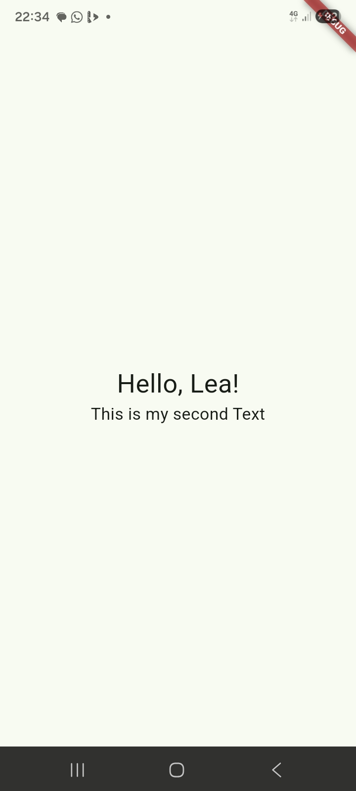

# my_first_app
Name:YUYAR LEA-BABARA BONGKEM

Lab 1: Introduction to Mobile Application Development.

## Screenshots

## What I did

- Installed Git, VS Code, the Flutter SDK and the Android SDK
- Ran the app on a real phone (SM A075F, Android 16)
- Changed the greeting, the theme seed colour, and added a second Text in a Column
- Printed the screen width with debugPrint: 384.0 dp

## What I learned and what blocked me
The exercise was abit challenging especially in the following area
.installing and setting up andriod studio sdk
.understanding what the git commands actually did
.understanding what things like hot reload means
I learnt a few things after surpassing these challenges like
.The hot reload shows the changes we have applied to the code on the phone without going through the long process of running it all over again
.The andriod studio sdk is needed to either run the code on a virtual device or inorder for the phone to run the flutter code
.Various git commands just do what we easily do on vs code like creating repositories synchinng changes made to the code and other stuff.